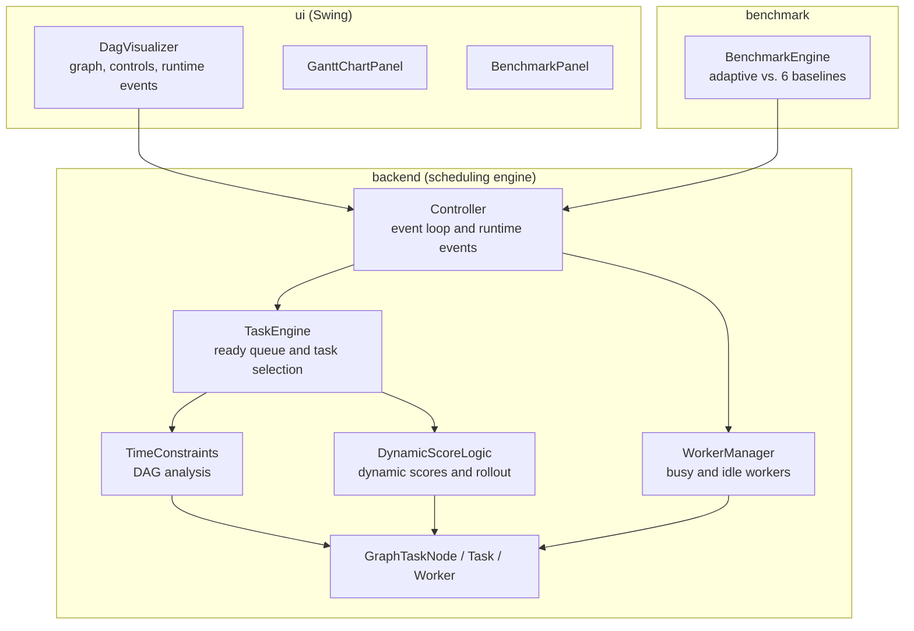
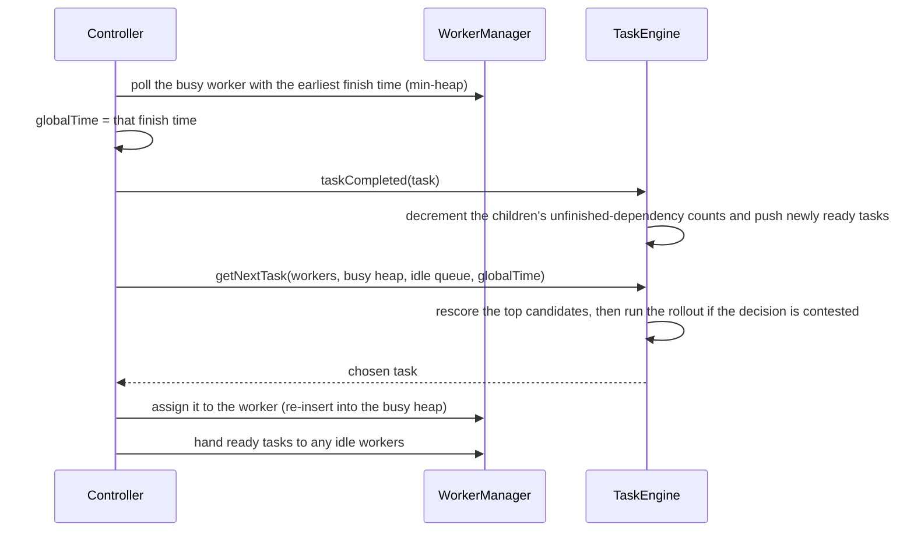

# Adaptive Task Scheduling Engine

[](https://github.com/Omri1227/adaptive-task-scheduler/actions/workflows/ci.yml)


A Java scheduler that assigns interdependent tasks to multiple workers. It models the project as a
**dependency graph (DAG)** and runs a **discrete-event simulation**. Every time a worker becomes free, it picks
the next task by combining graph algorithms, state-dependent scoring and a **bounded rollout simulation** of
the near future. A Swing visualizer shows every decision live.


## Highlights

- **Data structures:** an adjacency-list DAG, two binary heaps (the ready queue keyed by task priority, and busy
  workers keyed by finish time), a FIFO queue of idle workers, hash maps for O(1) lookup by ID, and a compact,
  array-based graph copy for fast simulation (details in [Data structures](#data-structures)).
- **Algorithms:** Kahn's topological sort with cycle detection, critical-path dynamic programming in reverse
  topological order, reachability analysis, an event-driven simulation loop, and a rollout look-ahead with a
  provable makespan lower bound.
- **Layered architecture:** the scheduling engine has no dependency on the UI. The visualizer and the benchmark
  use the same public `Controller` API.
- **Measured results:** the scheduler ties or beats six baseline strategies on all 10 built-in projects. On 800
  small graphs solved to optimality, it finds the optimal schedule 97.8% of the time, with an average gap of
  0.06%.
- **Runtime events:** workers and tasks can be added or removed, and tasks can finish early or late, in the
  middle of a run.
- **Tested:** input validation (cycles, duplicates, missing dependencies) and **135 JUnit tests**, run in CI
  on every push.

## Contents

[The problem](#the-problem) · [Architecture](#architecture) · [Data structures](#data-structures) ·
[Algorithms](#algorithms) · [Results](#results) · [Visualizer](#visualizer) ·
[Getting started](#getting-started) · [Testing](#correctness-and-testing) ·
[Research and presentation](#research-and-presentation)

## The problem

Each task has a duration and depends on other tasks. Several identical workers are available. A task can start
only after all of its dependencies finish. The goal is to finish the whole project as early as possible, which
means minimizing the **makespan**. This problem is NP-hard, so a practical scheduler needs a good heuristic.

Simple greedy rules fail in predictable ways:

```
        A
       / \
      B   C          Shortest-task-first may run C or F before B,
     / \   \         even though B unlocks two tasks and keeps more
    D   E   F        workers busy later on.
```

A short task that unlocks nothing can leave workers idle later, and delaying a task on the critical path delays
the whole project. So at every decision the scheduler asks: *which ready task, if started now, leads to the
best schedule overall?*

## Architecture

The system has three layers. The UI and the benchmark only call the engine's public API, so the engine can be
used and tested on its own.



| Component | Responsibility |
|---|---|
| `Controller` | Entry point and event loop. Advances simulated time to the next completion, asks the engine for the next task, and applies runtime events (add or remove a task or worker, early or late finish). |
| `TaskEngine` | Builds the graph from the task list and validates it. Owns the ready queue, chooses the next task (static and dynamic scores plus the rollout look-ahead), and releases tasks whose dependencies are done. |
| `TimeConstraints` | Graph algorithms: topological sort, cycle detection, critical paths, reachable work, blocking power and static scores. |
| `DynamicScoreLogic` | Scores a candidate using the current state, and runs the rollout simulation on a read-only model of the graph. |
| `WorkerManager` | Tracks busy workers (ordered by finish time) and idle workers (first in, first out), and handles adding and removing workers. |
| `GraphTaskNode` | A task inside the graph: its parents, children, the dependencies still unfinished, and its precomputed metrics. |
| `Task`, `Worker` | The external task definition, and a worker with its current task and history. |
| `BenchmarkEngine` | Runs the same project with the adaptive scheduler and six baseline rules, and compares their makespans. |
| `DagVisualizer`, `GanttChartPanel`, `BenchmarkPanel` | The Swing UI. It observes the engine and never changes a scheduling decision. |

### The event loop

The scheduler is a **discrete-event simulation**: time jumps straight from one task completion to the next,
without ticking through every time unit.



**Runtime events** reuse the same machinery:
- *Worker is late*: the worker is removed from the busy heap, its finish time is updated, and it is re-inserted,
  so the heap order stays correct.
- *Worker finishes early*: that worker's completion is processed out of order, at the given time.
- *Add or remove a task*: the engine rebuilds and revalidates the graph, so a new cycle is rejected. Running
  tasks are then re-attached to the new nodes.
- *Remove a busy worker*: the worker is marked and removed when its current task finishes (lazy deletion).

## Data structures

| Structure | Where | Why |
|---|---|---|
| **Adjacency lists** (`LinkedList<GraphTaskNode>` for children and parents) | `GraphTaskNode` | Stores the DAG. Traversals run in O(V + E). |
| **Unfinished-dependency list** per node (`parentsRemained`) | `GraphTaskNode` | A task becomes ready when its list is empty. Completing a task touches only its own children. |
| **Max-heap ready queue** (`PriorityQueue<GraphTaskNode>`, ordered by static score) | `TaskEngine.readyPQ` | The best candidates are taken in O(log n). Newly ready tasks are inserted in O(log n). |
| **Min-heap of busy workers** (`PriorityQueue<Worker>`, ordered by finish time, then by insertion order) | `WorkerManager` | The next event is always at the top, so advancing time is O(log W). The tie-breaker keeps runs deterministic. |
| **FIFO queue of idle workers** (`ArrayDeque<Worker>`) | `WorkerManager` | Free workers are assigned fairly, in order, with O(1) operations. |
| **Hash maps by ID** (`HashMap<Integer, GraphTaskNode / Task / Worker>`) | `TaskEngine`, `WorkerManager` | O(1) lookup for runtime events such as "worker 3 finished early". Also used for validation (duplicate IDs). |
| **Hash sets** | validation, reachability, BFS | Detect duplicate dependencies, collect each task's descendants, and mark visited nodes. |
| **Topological order** (`ArrayList<GraphTaskNode>`) | `TimeConstraints` | Computed once. Every dynamic-programming pass walks it forward or backward. |
| **Array-based graph model** (`int[]` durations and critical paths, `int[][]` children, `int[]` priority ranks) | `DynamicScoreLogic.RolloutModel` | A read-only, index-based copy of the graph used by the rollout. It is built once per graph, and primitive arrays avoid object allocation in the hot loop. |
| **Bit-packed event heap** (`PriorityQueue<Long>`, storing `end << 32 \| taskIndex`) | rollout simulation | One `long` encodes both the finish time and the task. Comparing the numbers orders events by time, with no `Event` objects needed. |

## Algorithms

### 1. Graph construction and validation: O(V + E)

`TaskEngine` maps each `Task` to a `GraphTaskNode` and links parents and children. It rejects duplicate IDs,
non-positive durations, dependencies on missing tasks and duplicate dependencies.
`TimeConstraints` then runs **Kahn's algorithm**. Tasks with no dependencies go into a queue. Each processed
task decrements its children's in-degrees, and a child that reaches 0 joins the queue. If the topological order
ends up shorter than the number of tasks, the graph has a **cycle**, and it is rejected.

```java
while (!q.isEmpty()) {
    GraphTaskNode current = q.poll();
    topologicalSort.add(current);
    for (GraphTaskNode child : current.getChildren()) {
        int newVal = inDegree.get(child.getId()) - 1;
        inDegree.put(child.getId(), newVal);
        if (newVal == 0) q.add(child);
    }
}
if (topologicalSort.size() != taskTotalNum) throw new RuntimeException("Task graph contains a cycle");
```

### 2. Static analysis: done once per graph

These passes compute each task's structural importance:

| Metric | Algorithm | Cost |
|---|---|---|
| **Critical path**: the longest chain of work from the task to the end of the project | Dynamic programming in reverse topological order: `cp(v) = duration(v) + max cp(child)` | O(V + E) |
| **Reachable work**: the total duration of the task and all its descendants | Union of the children's descendant sets, in reverse topological order | O(V²) worst case |
| **Blocking power**: how strongly the task gates its children | Breadth-first search; each child adds `1 / (its number of parents)` | O(V + E) |

They are combined into one normalized **static score**:

```
static = 0.5 · criticalPath / maxCriticalPath  +  0.25 · blockingPower / maxBlockingPower  +  0.25 · reachableWork / totalWork
```

### 3. Choosing the next task: at every decision

1. If only one task is ready, it is taken.
2. Otherwise, the **top 3 tasks by static score** are taken from the ready heap and rescored with a
   **dynamic score** based on the current state:

   | Component | Weight | Meaning |
   |---|---|---|
   | Open-to-block ratio | 0.20 | Share of the task's children for which it is the last unfinished dependency |
   | Open children vs. workers | 0.10 | How many children it would release, relative to the number of workers |
   | Child importance | 0.15 | Static scores of the children it would release |
   | Duration vs. load | 0.30 | Prefers long tasks when the queue is crowded and short ones when workers would idle |
   | Children vs. ready queue | 0.25 | Values releasing children more when the ready queue is short |

   Each candidate's final score is `(static + dynamic) / 2`.
3. If the decision is **contested** (more ready tasks than workers able to start one now), the **rollout
   look-ahead** chooses among the candidates. Otherwise, the task with the best combined score is chosen.
4. The candidates that were not chosen are returned to the heap.

### 4. Rollout look-ahead

The rollout compares five candidates: the three best by combined score, plus the next two by static score.
For each one, it simulates starting that task now, then lets the schedule continue for **8 completion events**.
In the simulation, idle workers immediately take ready tasks in static-priority order, and tasks that finish at
the same time are processed together. The candidate whose simulated future finishes earliest wins. On a tie,
the combined-score choice is kept.

```java
// TaskEngine.getNextTask: run the rollout only when the choice is contested
if (tasksAr[1] != null
        && originalPQSize > freeWorkersNow(employed, unemployed, globalTime)) {
    selected = rolloutLookahead(tasksAr, employed, unemployed, globalTime);
}
```

The simulation is itself a small discrete-event simulation over the array-based model. It uses the bit-packed
event heap for running tasks, a heap of ready tasks ordered by rank, and a counter array of unfinished
dependencies. It works only on **private copies**, so the real nodes, heaps and workers are never changed.
A test checks this.

```java
// DynamicScoreLogic.rolloutMakespan: the core loop
while (true) {
    while (free > 0 && !ready.isEmpty()) {                     // idle workers take ready tasks
        int j = ready.poll();
        running.add(((long) (t + model.duration[j]) << 32) | j);
        free--;
    }
    if (running.isEmpty()) return t;                           // finished: exact makespan
    if (events >= depth) return makespanLowerBound(...);       // horizon reached: lower bound
    t = (int) (running.peek() >>> 32);                         // jump to the next completion time
    while (!running.isEmpty() && (int) (running.peek() >>> 32) == t) {
        int j = (int) (running.poll() & 0xffffffffL);
        free++;
        for (int ch : model.children[j])                       // release children
            if (--remaining[ch] == 0) ready.add(ch);
    }
    events++;
}
```

If the simulated schedule does not finish within 8 events, the reached state is scored by a **provable lower
bound** on the final makespan, max(critical-path bound, work bound):
- *Critical-path bound*: every running task must finish and be followed by its longest remaining chain, and
  every ready task needs at least its critical path from now.
- *Work bound*: all remaining work, spread perfectly over all workers.

**Cost per contested decision:** at most 5 rollouts. Each one costs O(V) to set up plus up to 8 events at
O((W + children) · log V) each. A full schedule of 1,000+ tasks takes about 0.2 s.


<sub>From the presentation: a contested decision resolved by rollout. The combined score prefers T9, but the
simulated futures show that starting T6 finishes at 29 instead of 31. Here, 29 is the proven optimum.</sub>

### 5. Baseline strategies

`BenchmarkEngine` runs the same project with six simple priority rules: shortest task first, longest task
first, FIFO, critical path first, highest static score and largest downstream work. It reports each rule's
makespan next to the adaptive scheduler's.

## Results

### Built-in projects vs. baseline strategies

Makespan without runtime events (lower is better; ★ marks the best result). This is the same benchmark the
visualizer shows for each project.

| # | Project | Tasks / Workers | **Adaptive** | Shortest first | Longest first | FIFO | Critical path | Static score | Downstream work |
|---|---|---|---|---|---|---|---|---|---|
| 1 | Product Demo Video Release | 6 / 2 | **24 ★** | 28 | 27 | 27 | 27 | 27 | 27 |
| 2 | Mobile Checkout Feature Release | 8 / 2 | **27 ★** | 33 | 31 | 33 | 31 | 27 ★ | 31 |
| 3 | Executive Analytics Dashboard Rollout | 10 / 3 | **29 ★** | 33 | 32 | 33 | 29 ★ | 29 ★ | 33 |
| 4 | Boutique Hotel Opening | 14 / 3 | **42 ★** | 61 | 46 | 48 | 44 | 44 | 44 |
| 5 | Seller Marketplace Launch | 18 / 4 | **45 ★** | 55 | 50 | 55 | 50 | 51 | 51 |
| 6 | Fintech Payments Platform Release | 22 / 5 | **31 ★** | 33 | 35 | 33 | 32 | 32 | 34 |
| 7 | Music Festival Production | 28 / 6 | **69 ★** | 70 | 73 | 70 | 69 ★ | 69 ★ | 70 |
| 8 | Personalized Search Launch | 34 / 7 | **101 ★** | 105 | 106 | 105 | 101 ★ | 101 ★ | 101 ★ |
| 9 | Enterprise Data Center Exit | 42 / 8 | **99 ★** | 104 | 108 | 104 | 99 ★ | 99 ★ | 99 ★ |
| 10 | Global Subscription Platform Launch | 50 / 10 | **94 ★** | 97 | 97 | 96 | 94 ★ | 96 | 96 |

### Generated graphs

The scheduler was also evaluated on generated graphs: 8 graph families (layered, fork-join, tree, FFT, Gaussian
elimination, stencil, chains and random graphs), 10 to 1,500 tasks, and 2 to 64 workers.

- On **800 small graphs solved to optimality** with an exact solver, the scheduler found the optimal schedule
  in **97.8%** of cases, with an average gap to the optimum of **0.06%**.
- On **3,600 graphs of 10 to 600 tasks**, its makespan is on average within **3.1% of a lower bound** on the
  optimum. The bound is loose for large graphs, so the true gap is smaller.

The methodology (paired statistics, bootstrap confidence intervals, independent replication seeds) is in the
[research report](research/RESEARCH_REPORT.md).

## Visualizer

Pick one of ten projects, from 6 tasks / 2 workers up to 50 tasks / 10 workers, then step through the
schedule one event at a time (Space), play it automatically, or run it to the end. Runtime changes can be
applied at any point.

| Project selection | Finished schedule |
|---|---|
|  |  |

Expanded graph view during a run, with task states shown in color (gray: completed, blue: running, white: waiting):


## Getting started

Requirements: **JDK 21** and **Maven 3.9+**.

```bash
git clone https://github.com/Omri1227/adaptive-task-scheduler.git
cd adaptive-task-scheduler

mvn test                  # build and run the 135 tests
mvn compile exec:java     # launch the visualizer (main class: ui.Main)
```

The engine can also be used without the UI, through `backend.Controller`:

```java
Controller controller = new Controller(tasks, workerNames);   // builds and validates the DAG
controller.initial();                                          // static analysis + first assignments
controller.workerFinishOnTime();                               // advance to the next completion event
controller.workerIsLate(workerId, newFinishTime);              // runtime event
```

## Project structure

```
src/main/java/
├── backend/                 scheduling engine (no UI dependencies)
│   ├── Controller           event loop and runtime events
│   ├── TaskEngine           graph construction, ready queue, task selection, rollout
│   ├── DynamicScoreLogic    dynamic scores, rollout simulation, lower bound
│   ├── TimeConstraints      topological sort, cycle detection, static analysis
│   ├── WorkerManager        busy-worker heap and idle-worker queue
│   ├── GraphTaskNode, Task, Worker
│   └── ScenarioLibrary      the ten built-in projects
├── benchmark/               baseline strategies and the comparison report
└── ui/                      Swing visualizer (graph via JGraphX, Gantt chart, benchmark panel)
src/test/java/backend/       135 JUnit tests
research/                    research report, experiment harness and results
presentation/                project presentation (PDF + PPTX)
```

## Correctness and testing

The engine rejects invalid input: duplicate task or worker IDs, non-positive durations, dependencies on
missing tasks, duplicate dependencies and cyclic graphs, including cycles created by adding a task at runtime.
At runtime it guarantees that no task starts before its dependencies complete, and that no task is assigned to
two workers.

The 135 tests cover graph construction and each static metric (including large graphs), task completion, worker
management, dynamic scoring, runtime events, and regressions on the built-in projects. The rollout tests check
that:

- a full-depth rollout equals the static-priority list schedule;
- the estimate of a truncated rollout never exceeds the full rollout's makespan (so the lower bound is valid);
- a rollout never modifies the real nodes, workers or queues.

## Research and presentation

- [**Research report**](research/RESEARCH_REPORT.md): how the scheduler and its look-ahead were developed and
  validated. It covers the experimental setup, an exact solver for small instances, weight optimization
  (CMA-ES, Sobol sensitivity analysis), an analysis of when critical-path-first fails, and the limitations.
- [**Presentation (PDF)**](presentation/Adaptive_Task_Scheduler.pdf): 48 slides covering the problem
  formulation and NP-hardness proof, the scoring components, the look-ahead, the methodology and the results.

## Limitations and future work

- All evaluation instances are synthetic, with identical workers and known durations.
- The rollout uses a simplified continuation policy, so it can still miss the best choice on some instances.
- Computing reachable work with sets is O(V²) in the worst case. Bitsets or a summed DP would scale better
  for very large graphs.
- Possible extensions: workers with different skills or speeds, uncertain task durations, and a look-ahead
  whose depth adapts to the graph size.

## Tech stack

Java 21 · Swing · JGraphX · JUnit 4 · Maven · GitHub Actions

---

Developed by **Omri Schein**.
