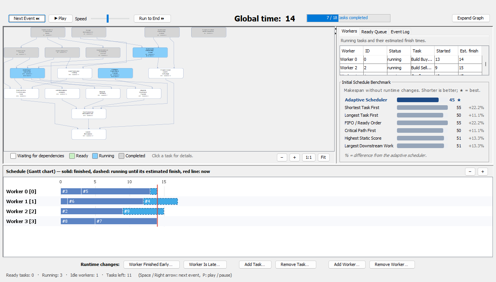
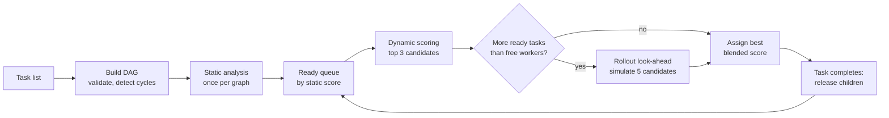
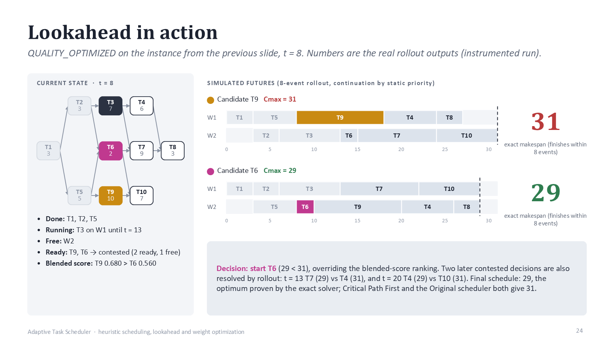
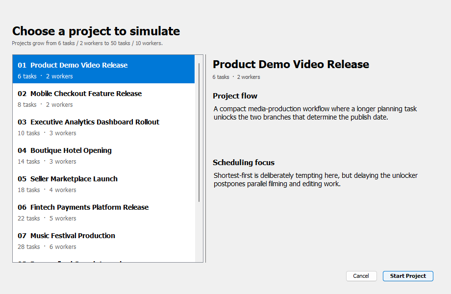
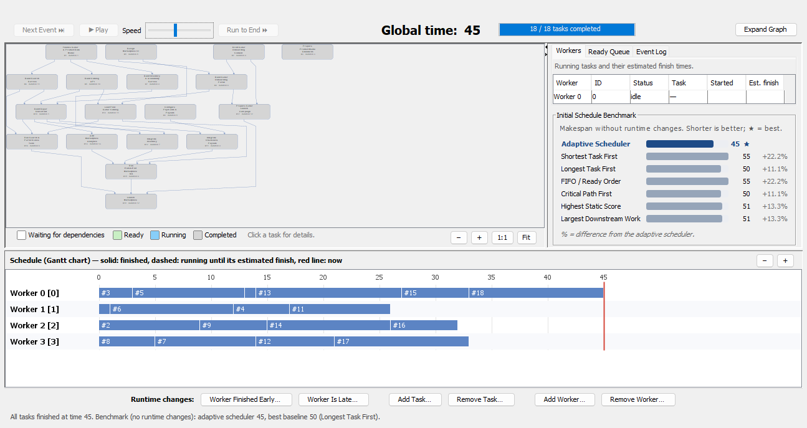
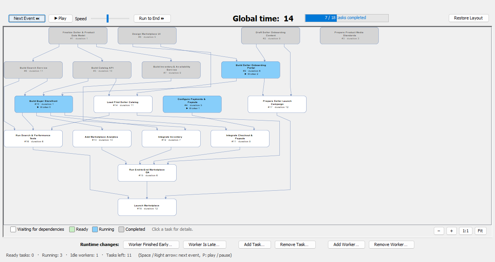

# Adaptive Task Scheduling Engine

[](https://github.com/Omri1227/adaptive-task-scheduler/actions/workflows/ci.yml)


A Java scheduler that assigns interdependent tasks to multiple workers. It models the project as a
**dependency graph (DAG)** and, every time a worker becomes free, picks the next task by combining graph
analysis, state-dependent scoring and a **bounded rollout simulation** of the near future.
A Swing visualizer shows every decision live.



## Highlights

- **Scheduling algorithm:** static graph analysis (critical path, blocking power, reachable work), a dynamic score
  recomputed at each decision, and a rollout look-ahead that simulates the top candidates forward and picks the
  one with the smallest estimated makespan.
- **Results that were measured:** on all 10 built-in projects the scheduler ties or beats six baseline strategies.
  On 6,000 generated graphs the rollout look-ahead cuts makespan by about 1% compared with the original
  look-ahead (Wilcoxon p < 1e-4). On graphs solved exactly, it is within **0.06% of the optimum**.
- **Dynamic runtime events:** workers and tasks can be added or removed, and tasks can finish early or late,
  in the middle of a run. The scheduler adapts without restarting.
- **Correctness first:** input validation (cycles, duplicates, missing dependencies) and **135 JUnit tests**
  (unit, integration and regression tests) run in CI on every push.
- **Research process:** the look-ahead was chosen through controlled experiments with paired statistics, an
  exact solver for small instances, and independent replication seeds
  ([research report](research/RESEARCH_REPORT.md), [presentation](presentation/Adaptive_Task_Scheduler.pdf)).

## The problem

Each task has a duration and depends on other tasks. Several identical workers are available. The goal is to
finish the whole project as early as possible, which means minimizing the **makespan**. This problem is NP-hard,
so a practical scheduler needs a good heuristic.

Simple greedy rules fail in predictable ways:

```
        A
       / \
      B   C          Shortest-task-first may run C or F before B,
     / \   \         even though B unlocks two tasks and keeps more
    D   E   F        workers busy later on.
```

A short task that unlocks nothing can leave workers idle later, and delaying a task on the critical path delays
the whole project. The scheduler therefore asks, at every decision: *which ready task, if started now, leads
to the best schedule overall?*

## How it works



**1. Static analysis (once per graph).** Every task gets a structural importance score:

```
static = 0.5 · criticalPath / maxCriticalPath
       + 0.25 · blockingPower / maxBlockingPower
       + 0.25 · reachableWork / totalWork
```

- *Critical path*: the longest chain of work from the task to the end of the project.
- *Blocking power*: how strongly the task gates its children. Each child adds 1 / (its number of parents).
- *Reachable work*: the total duration of the task and everything downstream of it.

**2. Dynamic scoring (at every decision).** The three best ready tasks are rescored using the current state:
the ratio of open to blocked work, how many children would become ready compared with the number of free
workers, the importance of those children, the task's duration relative to the ready tasks, and how the ready
queue would grow. The final score is the average of the static and dynamic scores.

**3. Rollout look-ahead (only on contested decisions).** When more tasks are ready than workers can start,
the scheduler compares five candidates: the three best by blended score and the next two by static score.
For each one, it simulates starting that task now, then continues the schedule for **8 completion events**.
The simulation runs on private copies of the state, so the real queue and workers are never changed.

```java
// TaskEngine.getNextTask: run the rollout only when the choice is contested
if (tasksAr[1] != null
        && originalPQSize > freeWorkersNow(employed, unemployed, globalTime)) {
    selected = rolloutLookahead(tasksAr, employed, unemployed, globalTime);
}
```

Each simulated future is scored by its estimated makespan. If the simulation finishes within 8 events, the
score is the exact makespan. Otherwise it is a provable lower bound:

```java
// DynamicScoreLogic.makespanLowerBound: critical-path bound vs. work bound
for (long r : running) {                       // running task: its end + the chain after it
    int end = (int) (r >>> 32);
    int j = (int) (r & 0xffffffffL);
    work += end - t;
    bound = Math.max(bound, (long) end + model.bottomLevel[j] - model.duration[j]);
}
for (int j : ready) {                          // ready task: now + its critical path
    bound = Math.max(bound, (long) t + model.bottomLevel[j]);
}
long workBound = t + (work + workers - 1) / workers;   // remaining work spread over all workers
return (int) Math.max(bound, workBound);
```

The candidate with the smallest estimate wins. On a tie, the blended-score choice is kept.


<sub>From the presentation: how a rollout resolves a contested decision. The blended score prefers T9, but
simulating both futures shows that starting T6 finishes at 29 instead of 31. In this example 29 is the proven
optimum, and critical-path-first gives 31. The example was produced with a research configuration of the
scheduler; the rollout mechanism is the same one that ships.</sub>

## Results

### Built-in projects vs. baseline strategies

Makespan without runtime events (lower is better; ★ marks the best result). This is the same benchmark the
visualizer shows for each project.

| # | Project | Tasks / Workers | **Adaptive** | Shortest first | Longest first | FIFO | Critical path | Static score | Downstream work |
|---|---|---|---|---|---|---|---|---|---|
| 1 | Product Demo Video Release | 6 / 2 | **24 ★** | 28 | 27 | 27 | 27 | 27 | 27 |
| 2 | Mobile Checkout Feature Release | 8 / 2 | **27 ★** | 33 | 31 | 33 | 31 | 27 ★ | 31 |
| 3 | Executive Analytics Dashboard Rollout | 10 / 3 | **29 ★** | 33 | 32 | 33 | 29 ★ | 29 ★ | 33 |
| 4 | Boutique Hotel Opening | 14 / 3 | **42 ★** | 61 | 46 | 48 | 44 | 44 | 44 |
| 5 | Seller Marketplace Launch | 18 / 4 | **45 ★** | 55 | 50 | 55 | 50 | 51 | 51 |
| 6 | Fintech Payments Platform Release | 22 / 5 | **31 ★** | 33 | 35 | 33 | 32 | 32 | 34 |
| 7 | Music Festival Production | 28 / 6 | **69 ★** | 70 | 73 | 70 | 69 ★ | 69 ★ | 70 |
| 8 | Personalized Search Launch | 34 / 7 | **101 ★** | 105 | 106 | 105 | 101 ★ | 101 ★ | 101 ★ |
| 9 | Enterprise Data Center Exit | 42 / 8 | **99 ★** | 104 | 108 | 104 | 99 ★ | 99 ★ | 99 ★ |
| 10 | Global Subscription Platform Launch | 50 / 10 | **94 ★** | 97 | 97 | 96 | 94 ★ | 96 | 96 |

### Rollout look-ahead vs. the original look-ahead (generated graphs)

The rollout replaced an earlier idle-time-based look-ahead. Experiments showed that the earlier look-ahead
never improved schedules. Both versions were run on the same instances: 8 graph families, 10 to 1,500 tasks,
and 2 to 64 workers.

| Dataset | Instances | Makespan ratio new / original (geometric mean) | Wins / ties / losses |
|---|---|---|---|
| Main set (10–600 tasks) | 3,600 | **0.9893** (−1.04%) | 1,526 / 2,030 / 44 |
| Independent replicate | 2,400 | **0.9891** (−1.06%) | 1,056 / 1,315 / 29 |
| Extra-large (601–1,500 tasks) | 200 | 0.9958 (−0.42%) | 84 / 113 / 3 |
| Solved to optimality (2–10 tasks) | 800 | 0.9910 (−0.85%) | 98 / 702 / 0 |

On the exactly solved set, the average gap to the optimum falls from 0.98% to **0.06%**, and the share of
optimal schedules rises from 86.8% to 97.8%. The trade-off is runtime: about 1.4× the original on small
graphs and 2.8× on large ones (about 0.2 s for a full 1,000+ task schedule). The full methodology, confidence
intervals and limitations are in the [research report](research/RESEARCH_REPORT.md).

## Visualizer

Pick one of ten projects, from 6 tasks / 2 workers up to 50 tasks / 10 workers, then step through the
schedule one event at a time (Space), play it automatically, or run it to the end. Runtime changes can be
applied at any point. The visualizer only observes the scheduler; it never changes a decision.

| Project selection | Finished schedule |
|---|---|
|  |  |

Expanded graph view during a run, with task states shown in color (gray: completed, blue: running, white: waiting):



## Getting started

Requirements: **JDK 21** and **Maven 3.9+**.

```bash
git clone https://github.com/Omri1227/adaptive-task-scheduler.git
cd adaptive-task-scheduler

mvn test            # build and run the 135 tests
mvn compile exec:java   # launch the visualizer (main class: ui.Main)
```

The engine can also be used without the UI, through `backend.Controller`:

```java
Controller controller = new Controller(tasks, workers);   // validates the DAG
controller.initial();                                      // static analysis + first assignments
controller.workerFinishOnTime();                           // advance to the next completion
```

## Project structure

```
src/main/java/
├── backend/                 scheduling engine
│   ├── Controller           entry point: runs the schedule, handles runtime events
│   ├── TaskEngine           ready queue, candidate selection, rollout look-ahead
│   ├── DynamicScoreLogic    dynamic scores and the rollout simulation
│   ├── TimeConstraints      DAG construction, cycle detection, static scores
│   ├── WorkerManager        worker availability and active assignments
│   ├── GraphTaskNode, Task, Worker
│   └── ScenarioLibrary      the ten built-in projects
├── benchmark/               baseline strategies and the comparison report
└── ui/                      Swing visualizer (graph via JGraphX, Gantt chart, benchmark panel)
src/test/java/backend/       135 JUnit tests
research/                    research report, phase reports, comparison harness and results
presentation/                project presentation (PDF + PPTX) and the script that generates it
```

## Correctness and testing

The engine rejects invalid input: duplicate task or worker IDs, non-positive durations, dependencies on
missing tasks, duplicate dependencies and cyclic graphs. At runtime it guarantees that no task starts before
its dependencies complete, and that no task is assigned to two workers.

The test suite covers graph construction and static scores, task completion, worker management, dynamic
scheduling, runtime events and regressions on the built-in projects. `RolloutLookaheadTest` checks the
look-ahead specifically:

- a full-depth rollout equals the static-priority list schedule;
- a truncated rollout's estimate never exceeds the full rollout's makespan (the lower bound is valid);
- the rollout never modifies the real nodes, workers or queues.

A differential harness ([`research/final-integration`](research/final-integration)) also confirms that every
decision outside the look-ahead is identical to the original scheduler.

## Research and presentation

- [**Research report**](research/RESEARCH_REPORT.md): consolidated findings. It covers why the original
  look-ahead did not help, how the rollout was validated, weight optimization (CMA-ES, Sobol sensitivity
  analysis), when critical-path-first fails, and the limitations.
- [**Presentation (PDF)**](presentation/Adaptive_Task_Scheduler.pdf): 48 slides covering the problem
  formulation and NP-hardness, the scoring components, the look-ahead, the methodology and the results.

## Limitations and future work

- All evaluation instances are synthetic, with identical workers and known durations.
- The rollout's continuation policy is a simplification, so the rollout can still lose. It lost on about 1.2%
  of instances, by at most 5.9%.
- Possible extensions: size-gated look-ahead to reduce runtime on large graphs, workers with different skills
  or speeds, and uncertainty in task durations.

## Tech stack

Java 21 · Swing · JGraphX · JUnit 4 · Maven · GitHub Actions

---

Developed by **Omri Schein**.
